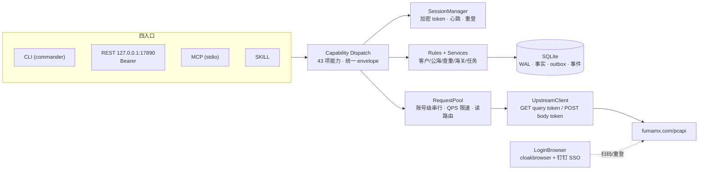

<p align="center">
  
</p>

<h1 align="center">fuma-platform</h1>

<p align="center">
  <b>孚盟（fumamx.com）本地封装平台</b><br>
  多账号会话池 · 请求池 · 本地事实库 · 海关缓存 · 事件总线 —— 一次封装，四种入口
</p>

<p align="center">
  <a href="LICENSE"></a>
  
  
  
  
</p>

<p align="center">
  <a href="docs/快速开始.md">快速开始</a> ·
  <a href="docs/运维部署手册.md">运维部署</a> ·
  <a href="docs/generated/CLI参考.md">CLI 参考</a> ·
  <a href="docs/generated/REST-API.md">REST API</a> ·
  <a href="docs/generated/MCP工具.md">MCP 工具</a> ·
  <a href="docs/10-实现进度与验证报告.md">验证报告</a>
</p>

---

## 为什么需要它

孚盟是公司客保库，但它的 PC 网页端只适合真人操作：多账号、扫码登录、会话会掉、接口没有 SDK、频率需要控制。
**lead platform 负责业务编排，本平台只做孚盟侧的薄封装**——把「客户管理（客户/公海/查重/联系人/跟进）」与「海关数据（按公司查询）」变成可编程、可缓存、可审计、可订阅的本地能力。

- 🧠 **本地事实优先**：写操作先落本地事务 + outbox，再异步同步上游；上游冲突自动收敛，返回给编排层的永远是确定事实。
- 🚀 **登录一次，长期可用**：钉钉 SSO 扫码 → 自动选组织/企业 → token 加密落库 → 心跳保活 + 到期重登队列。
- 🗄️ **海关数据本地缓存**：强制缓存、TTL、上游更新日志失效、LRU 容量、权限域隔离；命中路径 **0.2ms**（实测）。
- 🧩 **单一能力注册表**：44 项能力同时生成 CLI / REST / MCP / spec / docs，不会出现入口不一致。

## 核心能力

| 模块 | 能力 | 说明 |
|---|---|---|
| 🔐 账号与会话 | `account.*` / `session.*` | 多账号、扫码登录、二维码渲染、心跳、状态/在线检查、登出 |
| 👥 客户（客保） | `customer.list/get/create/update/delete` | 客户列表/详情（缓存优先）、建档、编辑、删除（权限受限时明确报错） |
| 🌊 公海 | `open_sea.list/claim/release` | 公海列表、领取（**强制先查后领**）、释放、3 天冷却 |
| 🔁 查重 | `dedup.check/history/batch` | 查重、历史、批量任务化（taskId + 进度 + 结果） |
| 📇 联系人 | `contact.list/create` | 按客户查询、创建（本地优先 + edit_customer 同步，**已真实验证**） |
| 📝 跟进 | `followup.list/create` | 跟进时间线、创建（本地优先 + `bill/add_one` 同步，已真实验证） |
| 🚢 海关 | `customs.query/dictionaries/cache.*` | 按公司查询（MVP）、字典、缓存统计/清理 |
| ⚙️ 同步 | `sync.status/reconcile/retry` | outbox 状态、对账收敛、失败重试 |
| 📡 事件 | `event.list/purge` | `sinceSeq` 轮询；归档/清理历史事件（30 天保留 + 手动 purge） |
| 🧵 任务 | `task.get/list/cancel` | 批量任务化，进度/结果/取消 |
| 🩺 运维 | `system.health/status/doctor` | 健康检查、详细状态、自检 |

> 规则不变式（本地强制）：容量上限（默认 500，按角色规则解析）、15 天保护期、释放后 3 天冷却、领取前必须查重。

## 架构

<p align="center">
  
</p>



- 常驻只有 Node 进程；浏览器仅在登录/重登/二维码刷新时拉起（`keepBrowserAlive=false` 默认）。
- 数据目录 `~/.fuma-platform`：`data/fuma.db`、`secret.key`、`profiles/`、`logs/`、`backups/`、`qr/`。

## 快速开始

```bash
# 1) 安装依赖 + 构建 + 初始化 + systemd user service
git clone https://github.com/CindyRIng/fuma-platform.git && cd fuma-platform
./scripts/install.sh

# 2) 创建账号（扫码登录前）
fuma account create acct_01 --name "业务员A" --owner-name "业务员A"

# 3) 扫码登录（终端打印二维码，手机钉钉确认）
fuma session login acct_01

# 4) 只读
fuma customer list --page-size 5
fuma customer get <customerId> --fresh
fuma open-sea list --page-size 5
fuma dedup check "某公司名称"
fuma customs query "Ningbo" --page-size 5     # 第二次命中本地缓存

# 5) 写入（本地优先，异步同步上游）
fuma open-sea claim --account acct_01 <customerId> --idempotency-key demo-1
fuma customer create --account acct_01 --data '{"custName":"ZZ_TEST_示例","custShortName":"ZZ"}'
fuma contact create --account acct_01 --customer <customerId> --data '{"contName":"ZZ_TEST_联系人","mobile":"13800001234"}'
fuma sync status
fuma event list --since-seq 0
fuma service status   # 查看正在运行的 daemon（pid/uptime 才是服务进程）
```

REST / MCP：

```bash
fuma serve &   # http://127.0.0.1:17890
TOKEN=$(node -e "console.log(JSON.parse(require('fs').readFileSync(process.env.HOME+'/.fuma-platform/config.json','utf8')).server.apiToken)")
curl -s -H "Authorization: Bearer $TOKEN" http://127.0.0.1:17890/v1/health
curl -s -H "Authorization: Bearer $TOKEN" -X POST http://127.0.0.1:17890/v1/customers/list -H 'content-type: application/json' -d '{"page":1,"pageSize":5}'
open http://127.0.0.1:17890/v1/docs        # Swagger UI 交互式 API 文档（本地静态资源，无需外网）
curl -s http://127.0.0.1:17890/v1/openapi.json | head

fuma mcp    # MCP stdio，供 Claude/其他 Agent 直接调用
```

## 真实验证（2026-11-15，生产账号）

| 链路 | 结果 | 证据 |
|---|---|---|
| 扫码登录 | ✅ 全自动 | starting → qr_ready → scanned → consented → redirected → enterprise_select → **online**（24h token） |
| 客户列表/详情 | ✅ | totalNum=491；fresh 直连上游 |
| 公海/查重/跟进/联系人读 | ✅ | 379,597 / 892ms / 582 / 518 |
| 海关按公司查询 | ✅ | tradeList ≈19,514,697；冷查 1.3s → 缓存命中 **1ms** |
| 客户建档/编辑 | ✅ | ZZ_TEST 测试客户创建、编辑备注成功 |
| **联系人新增** | ✅ | 平台 REST → outbox → `edit_customer(master.contacts)` → 上游可见（contact.list fresh=2） |
| **跟进新增** | ✅ | 浏览器抓包确认 `bill/bill/add_one` → 平台 outbox 同步成功，上游可查（2 条 ZZ_TEST 测试跟进待管理员清理） |
| outbox/事件/对账 | ✅ | 领取 outbox 同步成功；reconcile 收敛上游事实并记录 diff |

> 测试数据均以 `ZZ_TEST_*` 命名并备注清理说明；平台账号无客户删除权限（上游 1114），2 条测试跟进删除接口未生效，均需管理员协助清理。

## 性能

| 场景 | 数据 |
|---|---|
| 50 账号池读（mock 2ms 上游） | p50 **3.3ms** / p95 **3.8ms** / **280 QPS** |
| 海关缓存命中 | p50 **0.11ms** / p95 **0.15ms**（命中率 100%） |
| outbox 同步（100 次领取） | **358 ops/s** |
| 真实上游延迟 | 客户列表 944ms / 详情 720ms / 公海 1.0s / 跟进 3.3s / 海关冷查 773ms |

SQLite 已开启 WAL / `synchronous=NORMAL` / 64MB cache / mmap 256MB / prepared statement cache；
请求池按账号串行 + QPS 间隔 + 抖动；海关缓存 gzip + TTL + 更新日志水位 + LRU（默认 20 万条 / 2GB）。

## 文档

| 分类 | 文档 |
|---|---|
| 🚀 上手 | [快速开始](docs/快速开始.md) · [README](docs/README.md) |
| 🔧 运维 | [运维部署手册](docs/运维部署手册.md)（systemd、备份恢复、升级回滚、排障、安全） |
| 📖 接口 | [CLI 参考](docs/generated/CLI参考.md) · [REST API](docs/generated/REST-API.md) · [MCP 工具](docs/generated/MCP工具.md) · [能力总览](docs/generated/能力总览.md) |
| 📐 契约 | [上游接口契约](docs/03-上游接口契约-孚盟.md) · [平台 API 契约](docs/04-平台API契约.md) · [数据模型与同步](docs/05-数据模型与同步设计.md) |
| 🧭 设计 | [项目总览与架构](docs/01-项目总览与架构.md) · [需求规格与规则](docs/02-需求规格与业务规则.md) · [登录与会话](docs/06-登录与会话管理.md) · [实现设计](docs/07-实现设计与工程规范.md) |
| ✅ 验证 | [实现进度与验证报告](docs/10-实现进度与验证报告.md) · [性能与容量报告](docs/性能与容量报告.md) |

## 开发

```bash
npm install
npm run typecheck
npm test            # 65 个用例
npm run build
npm run spec        # spec/openapi.json · cli-commands.json · mcp-tools.json
npm run docs:gen    # docs/generated/*
npm run bench       # 50 账号 mock 压测
```

## 状态与已知限制

- **v1.0.6**：P2–P6 完成；systemd 部署运行中；GitHub public（MIT）。
- ⚠️ **删除客户**：当前验证账号无删除权限（上游 1114），平台如实返回错误；需管理员或换有权限账号。
- ⚠️ **扫码登录**：首次需人工扫码一次；之后心跳保活，24h 令牌到期后按重登策略处理（正在进行 24h 保活观察）。
- ⚠️ **海关范围**：仅按公司查询；产品/交易分析、贸易监测不在 MVP。
- ⚠️ **真实 50 账号压测**：当前为 50 账号 mock 基准；真实多账号需在目标环境扩展。

## 安全

- `.env`、`~/.fuma-platform/secret.key`、token、数据库均权限 600，已被 gitignore。
- token 使用 **AES-256-GCM** 加密存储；日志与事件默认脱敏。
- REST 默认仅监听 `127.0.0.1`，需 Bearer Token；MCP 走 stdio。
- 合规提醒：账号为真实业务员账号，请遵守孚盟使用条款，控制访问频率。

## License

[MIT](LICENSE) © 2026 fuma-platform contributors
